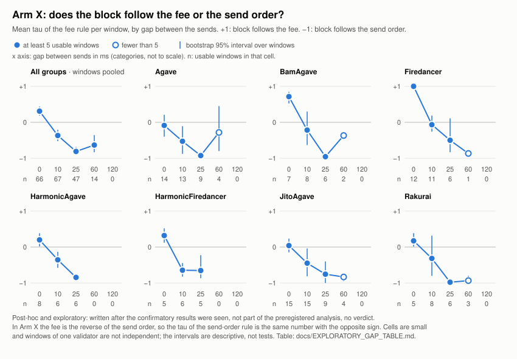

# solana-leader-window-lab

[](https://github.com/FraklinSaint/solana-leader-window-lab/actions/workflows/ci.yml)

**Inside the Block: How Solana Validators Order Transactions** (Superteam Ukraine bounty; full text
in [docs/BOUNTY.md](docs/BOUNTY.md)).

We send small, controlled bursts of our own transactions into the leader windows of chosen
mainnet validators (after Alpenglow). From the produced blocks we decide which candidate ordering
rule each validator follows, how strictly, or whether no rule explains the order. The unit is one
leader window (4 slots); the primary evidence is only our own transactions.

> **Status (2026-11-03): measurement finished and frozen (tag `data-freeze`); the confirmatory
> analysis was run once, from the tagged procedure (tags `analysis-pre-run-2`, `confirmatory-results`).**
> Everything under "Results at a glance" is MEASUREMENT from
> `analysis/results/confirmatory_2026-11-03/`. Simulator output is always labeled SIMULATION.
> The full table is [docs/REPORT.md](docs/REPORT.md) (generated, never hand-edited).

**Contents:** [Results](#results-at-a-glance) · [Reproduce in one command](#reproduce-in-one-command) ·
[Check one transaction by hand](#check-one-transaction-by-hand) ·
[Where each bounty requirement is met](#where-each-bounty-requirement-is-met) ·
[Registration order](#registration-order-what-a-third-party-can-check) ·
[What went wrong](#what-went-wrong-and-what-this-does-not-show) · [Why this design](#why-this-design) ·
[Bounty considerations](#bounty-considerations-one-subsection-each) ·
[What this does NOT separate](#what-this-does-not-separate) · [Running the sender](#quick-start)

## Results at a glance

**What was measured.** Six sessions on a Windows PC over Wi-Fi, 2026-10-26 to 2026-11-02, all after
Alpenglow (slots 461,826,696 to 464,527,566): 1,185 leader windows (890 usable), 7,110 own
transactions (6,243 landed), 10 validators in 7 client groups (9 measurable). All fees, including
calibration and funding transfers, came to 38,905,322 lamports (0.0389 SOL) against a 0.05 SOL
ceiling that is a compile-time constant (`crates/common/src/limits.rs`). No Jito bundles or tips.
The date of every window is in [docs/REPORT.md](docs/REPORT.md); the six runs:

| Run | Started (UTC) | Registered as | Windows sent / usable | Transactions sent / landed | Slots |
|---|---|---|---|---|---|
| `live-20261026T220348Z` | 2026-10-26 22:03 | session 1 | 188 / 156 | 1,128 / 1,006 | 461,826,696 to 461,927,524 |
| `live-20261027T214442Z` | 2026-10-27 21:44 | session 2 | 249 / 167 | 1,494 / 1,086 | 462,227,404 to 462,328,752 |
| `live-20261028T165833Z` | 2026-10-28 16:58 | session 3 | 171 / 133 | 1,026 / 887 | 462,552,664 to 462,619,564 |
| `live-20261028T213507Z` | 2026-10-28 21:35 | session 4 | 239 / 179 | 1,434 / 1,253 | 462,630,317 to 462,722,539 |
| `live-20261029T223027Z` | 2026-10-29 22:30 | session 5 (amendment 1) | 246 / 200 | 1,476 / 1,460 | 463,049,896 to 463,201,228 |
| `live-20261102T123839Z` | 2026-11-02 12:38 | round 2 (amendment 2) | 92 / 55 | 552 / 551 | 464,498,385 to 464,527,566 |
| all | | | 1,185 / 890 | 7,110 / 6,243 | |

**Short answer** to the bounty's three questions (by what rule, how strictly, whether there is a rule at all),
to be read together with the controls below. tau is the mean Kendall tau over usable windows (+1: the block follows
the rule exactly):

- **Rule.** At Firedancer `9eGrDohd` the order follows the priority fee **per requested compute unit**, not the
  total fee: that rule has tau +1.00 in Arm R (equal price, different compute-unit limits; 20 windows) and the total
  fee -1.00. Vanilla Agave and JitoAgave `HEL1USMZ` lean the same way, weakly (per compute unit SOFT, total fee INCONCLUSIVE or
  NO_RULE). BamAgave is strictly price-ordered in Arms P and C, where every transaction requests the same
  compute-unit limit, so fee, fee per unit and total fee are not separated there (Arm R was not run). Send time
  takes over when transactions do not arrive together: with simultaneous sends (gap 0 ms) price decides at
  Firedancer (+1.00) and BamAgave (+0.71); with 25 ms between sends the earlier-sent transaction tends to go first
  in every group.
- **Strictness.** STRICT: Firedancer (Arms P, C and R) and BamAgave (Arm C 0.96; Arm P 0.81 with a
  low-separation label). The other Agave-family validators and HarmonicFiredancer show a measurable but incomplete
  effect of price (mostly SOFT, tau about 0.2 to 0.6, a few cells inconclusive). The Agave positive control failed,
  so we cannot say whether that incompleteness belongs to the scheduler or to our path.
- **Ties** (equal fee, Arm F). Firedancer puts the later-sent transaction first (LIFO, +0.42), as predicted from
  its source before the first send. HarmonicAgave, HarmonicFiredancer and Rakurai put the earlier-sent first
  (FIFO, +0.39 to +0.48), and so does JitoAgave `HEL1USMZ` (+0.26). Vanilla Agave (predicted), BamAgave and JitoAgave
  `E1r4Psq8`: no determinant found.
- **Is there a rule at all?** For every measurable validator at least one candidate rule is significant after Holm
  correction. NO_RULE (not significant although the test had 90% power for a half-strength version of the rule) appears in only 3 of 191 cells and
  INCONCLUSIVE in 75: in the lock-free arms the noise is large, and we report that instead of calling it a rule.

**The controls, first.**

| Control | Result |
|---|---|
| Positive control (Agave, Arm C, mean raw tau of `R_RATIO_AGAVE`; PREREGISTRATION §7) | **FAILED.** 0.5333 over 35 usable windows (0.535 with equal validator weights) against the simulator's 95% interval [0.6310, 1.0000]; the three sensitivity intervals fail too ([0.6521, 1.0], [0.6310, 1.0], [0.5867, 1.0] at W = 10). §7 says this weakens every Agave-family verdict (the simulator's `agave` family: Agave, JitoAgave, HarmonicAgave, BamAgave and Rakurai). We read those verdicts as "price has a measurable but incomplete effect", not as a measure of strictness. We do not know the cause: per run the Arm C mean is 0.45 to 0.65, with too few windows per cell to say more ([docs/EXPLORATORY_GAP_TABLE.md](docs/EXPLORATORY_GAP_TABLE.md) §2). |
| Negative control (labels shuffled inside windows, 20 shuffles per family, 51 families; ANALYSIS_CLARIFICATIONS_PRE_RUN (b)) | **Passed.** At most 2 hits in any family (limit 3), no family over the limit. |

**What the blocks show** (verdict names are those of PREREGISTRATION §8; `STRICT` = the block follows
the rule and meets the simulator's thresholds, `SOFT` = a significant tendency that is not strict;
Arm P: fee varies, send order random; Arm C: all transactions write-lock one account; Arm X: fee is
the reverse of the send order, gap 0 to 120 ms between sends):

| Group (validators) | Arm P | Arm C | Arm X |
|---|---|---|---|
| Firedancer (`9eGrDohd`; `EvnRmnMr` never landed a transaction, 0 of 75 windows usable) | price STRICT, tau 1.00 (30 of 30 windows) | price STRICT, 0.83 | fee decides at gap 0 ms (tau +1.00, 12 windows); from 25 ms send order tends to win (-0.50, 6 windows, interval includes 0) |
| BamAgave (`DRpbCBMx`; lands only 74 to 83% of its transactions) | price STRICT_LOW_SEPARATION, 0.81 | price STRICT, 0.96 | fee at 0 ms (+0.71), send order at 25 ms (-0.96) |
| Agave (`5Us18hLZ`, `7QQGNm3p`, pooled) | price SOFT, 0.21 | price SOFT, 0.54 (control failed) | send order SOFT (FIFO +0.44, price -0.44); at 0 ms neither decides (-0.09) |
| JitoAgave (`E1r4Psq8`, `HEL1USMZ`) | price SOFT 0.20 / INCONCLUSIVE 0.15 | price SOFT, 0.37 / 0.54 | send order SOFT, 0.37 / 0.39 |
| HarmonicAgave (`Fd7btgyS`) | INCONCLUSIVE, 0.03 | price SOFT, 0.60 | send order SOFT, 0.28 |
| HarmonicFiredancer (`JUPiTERr`) | price SOFT, 0.26 | price SOFT, 0.57 | send order SOFT, 0.35 |
| Rakurai (`ana2y2Yv`; lands 68 to 78% of its transactions) | price STRICT_LOW_SEPARATION, 0.36 | price INCONCLUSIVE (0.20), send order SOFT (0.56) | send order SOFT, 0.47 |

Equal fee, and equal price with different compute-unit limits (Arm F: same fee, fixed send order 10 ms apart,
which tie-break? Arm R: same price per compute unit, six different compute-unit limits, random send order):

| Group (validators) | Arm F: tie-break | Arm R: fee per compute unit vs total fee |
|---|---|---|
| Firedancer (`9eGrDohd`) | later-sent first (LIFO), SOFT, +0.42 (30 windows); ties by payer key are weakly significant too (+0.18) | fee per compute unit STRICT, +1.00 (20 windows); total fee -1.00 |
| BamAgave (`DRpbCBMx`) | none found (all four tie rules INCONCLUSIVE, tau within ±0.08; 20 windows) | not measured |
| Agave (`5Us18hLZ`, `7QQGNm3p`, pooled) | none found (INCONCLUSIVE, 47 windows), as predicted | per compute unit SOFT, +0.29 / +0.25 (47 windows pooled); total fee NO_RULE |
| JitoAgave (`E1r4Psq8`, `HEL1USMZ`) | `E1r4Psq8` none found; `HEL1USMZ` earlier-sent first (FIFO), SOFT, +0.26 | `E1r4Psq8` INCONCLUSIVE +0.12; `HEL1USMZ` SOFT +0.20 |
| HarmonicAgave (`Fd7btgyS`) | earlier-sent first (FIFO), SOFT, +0.39 (21 windows) | not measured |
| HarmonicFiredancer (`JUPiTERr`) | earlier-sent first (FIFO), SOFT, +0.42 (15 windows) | not measured |
| Rakurai (`ana2y2Yv`) | earlier-sent first (FIFO), SOFT, +0.48 (20 windows) | not measured |

Arm R was run for the three required groups only (Agave, JitoAgave, Firedancer). Per-validator values for every arm:
[docs/VALIDATORS.md](docs/VALIDATORS.md) and [docs/REPORT.md](docs/REPORT.md).

Verdict counts over all 191 validator x arm x rule cells: 17 STRICT, 9 STRICT_LOW_SEPARATION, 87
SOFT, 3 NO_RULE, 75 INCONCLUSIVE. Without the last session (round 2) four X-arm verdicts change
class and nothing else does (`analysis/results/confirmatory_2026-11-03_sensitivity_no_round2/`).

**How to read it.** The registered X verdicts pool the send gaps. Split by gap (a post-hoc,
exploratory table, no verdicts; [docs/EXPLORATORY_GAP_TABLE.md](docs/EXPLORATORY_GAP_TABLE.md))
the picture is clearer. When sends are simultaneous (gap 0 ms) price decides the order at Firedancer (+1.00,
12 windows) and, less so, at BamAgave (+0.71); at the other Agave-family validators (Agave -0.09, JitoAgave +0.04,
HarmonicAgave +0.20, Rakurai +0.17) and at HarmonicFiredancer (+0.32, 5 windows) neither price nor send order
decides clearly. At a 10 ms gap price and send order are mixed (all groups -0.37; Firedancer -0.07). At 25 ms the
earlier-sent transaction tends to go first in every group (tau of price -0.65 to -0.98 in six groups; Firedancer
-0.50 over 6 windows, with an interval that includes 0; 47 usable windows in all). In other words, in our data a
priority fee helped only against transactions that arrived (nearly) together; with 10 ms or more between sends,
send order mattered as much or more. These are conclusions about the validators we measured on the dates we
measured them, over our Wi-Fi path, not about a client in general. Gaps of 60 and 120 ms mostly spread a window
over more than one slot and are unusable (0 of 70 windows at 120 ms).



*Post-hoc, exploratory; generated by `scripts/gap_figure.py` from `data/` (the numbers are the table's).
Per-validator identification and results: [docs/VALIDATORS.md](docs/VALIDATORS.md).*

**Predictions registered before the data, and what happened.** The design text with these predictions
(`docs/PREREGISTRATION.md` §4, §5, §5b; `docs/VERIFIED_FACTS.md` F6, F6b; derived from the scheduler source code and
the simulator) was on GitHub on 2026-10-25 12:12:44 UTC (commit `25724f9`), before any send
([Registration order](#registration-order-what-a-third-party-can-check)).

| Prediction | Result |
|---|---|
| Firedancer ranks by the exact ratio of reward to compute cost; with one lock chain (Arm C) it is strict | **Held.** Arm C STRICT 0.83; also Arm P 1.00 and Arm R 1.00 |
| Agave ranks by the same ratio, but its 4 worker threads interleave lock-free transactions, so Arms P and R are noisy | **Held.** SOFT in P and R (tau 0.17 to 0.29) |
| Agave in Arm C (one thread, no interleaving) is close to strict: the positive control | **Did not hold.** SOFT; 0.5333 against the registered interval [0.6310, 1.0000]; cause unknown |
| Equal-fee ties: Agave by an internal index that cannot be told from random (TIE_NONE); Firedancer by the last arrival (LIFO) | **Held** for vanilla Agave (no tie rule significant, 47 windows) and Firedancer (LIFO +0.42; payer order also weak, +0.18). No prediction was registered for Harmonic or Rakurai (rule unpublished); all three show FIFO, as does one JitoAgave validator |
| Arm X: a priority scheduler follows price only when sends are close together; as the gap grows arrival order wins. Simulated at N = 8 for 0 / 10 / 25 ms: Firedancer +0.82 / +0.32 / -0.25, Agave +0.43 / 0.00 / -0.37 (`docs/SIMULATION.md`) | **Held in shape.** Measured at N = 6: Firedancer +1.00 / -0.07 / -0.50, Agave -0.09 / -0.53 / -0.93. Arrival order takes over earlier than simulated, most of all at Agave |

## Reproduce in one command

```bash
git clone https://github.com/FraklinSaint/solana-leader-window-lab && cd solana-leader-window-lab   # about 1.1 GB: raw blocks are committed
docker compose up                            # data check, registered analysis, comparison (3 to 20 minutes); needs no key
docker compose run --rm reproduce python scripts/reproduce.py --skip-verify    # analysis and comparison only (about 1 minute)
make reproduce                               # the same without Docker (Python 3.12, analysis/requirements.lock)
```

What it does, offline: (1) `scripts/verify_manifest.py` checks every claim in `data/manifest.jsonl` against
the saved blocks, plans, leader-schedule snapshots, slot lists and the spend ledger; (2) it runs the registered
command, `python -m slwlab.analyze --manifest ../data/manifest.jsonl --sim sim/results/sim_v2.json --data ../data --pooled Agave`;
(3) it re-checks the positive control; (4) it compares both result files number by number with the committed ones. It
ends with `REPRODUCED: ...` or `NOT REPRODUCED`, and its exit code says which. On a Linux machine
(Python 3.13, numpy 2.5.3) the two result files came out byte-identical to the ones produced on the
Windows PC (Python 3.12.12, numpy 2.5.4): 3,067 numbers, largest relative difference 0. CI repeats it in
the pinned image on every push. Raw evidence for any single claim: `data/manifest.jsonl` has the signature,
slot and block index of each of the 7,110 transactions; `RPC_URL=<mainnet rpc> python scripts/verify_manifest.py --online --sample 50`
re-fetches blocks with `getBlock` and compares them. If you call `getBlock` yourself, use
`"maxSupportedTransactionVersion": 1`: since Alpenglow about 4 in 10 transactions are version 1 (41% in a sample
of 30 of our saved blocks) and a request with `0` fails on those blocks. Blocks after Alpenglow carry no vote
transactions (VERIFIED_FACTS F1). The order in which things were done is in [docs/LOGBOOK.md](docs/LOGBOOK.md);
what a third party can check about it is the next section.

## Check one transaction by hand

The first line of `data/manifest.jsonl` is transaction `2ctcRfqc…` (Arm X, validator `Fd7btgyS`, slot 461,826,696). The
manifest says it sits at index 213 of a block with 471 transactions. Offline, from the saved block, with Python only:

```bash
python3 - <<'EOF'
import gzip, json
b = json.load(gzip.open("data/raw/blocks/461826696.json.gz"))
t = b["transactions"]
print(len(t), t[213]["transaction"]["signatures"][0])                  # 471 2ctcRfqckoQjo9g29JbkNR9ens...
print([r["pubkey"] for r in b["rewards"] if r["rewardType"] == "Fee"]) # ['Fd7btgySsrj...']: the block's producer
EOF
```

Against the chain, with any archival mainnet RPC (a free Helius key works): the order is the chain's, not ours.

```bash
curl -s "$RPC_URL" -H 'content-type: application/json' -d '{"jsonrpc":"2.0","id":1,"method":"getBlock","params":[461826696,{"maxSupportedTransactionVersion":1,"transactionDetails":"signatures","rewards":false}]}' \
  | python3 -c "import json,sys; s=json.load(sys.stdin)['result']['signatures']; print(len(s), s.index('2ctcRfqckoQjo9g29JbkNR9ensr3dqsWngvYhgNMrCbJumCpeTYCse3k3GffEGn7URYTzvtjDiMQURVs4b9tx4uG'))"   # 471 213
```

`scripts/verify_manifest.py` does this for all 7,110 transactions (offline) and for a sample or all blocks (`--online`).

## Where each bounty requirement is met

| Requirement | Where |
|---|---|
| Mainnet only, after Alpenglow, not mixed | The code refuses any slot below 459,653,000 (`crates/common`); all 7,110 transactions are later (check M of `verify_manifest.py`); [Safety invariants](#safety-invariants) |
| At least 6 validators, 3 client types | 10 validators in 7 groups, 9 measurable ([Results](#results-at-a-glance)); how each was identified (gossip `clientId`, version, Jito list, evidence) and what was measured at each: [docs/VALIDATORS.md](docs/VALIDATORS.md) |
| Fee spend limit enforced in code | `HARD_CEILING_LAMPORTS = 50_000_000` (compile-time constant) and a write-ahead ledger (`crates/common/src/limits.rs`, `data/ledger.jsonl`); total spent 38,905,322 lamports = 0.0389 SOL |
| Our own transactions as the primary evidence | All 7,110 analyzed transactions are ours; other transactions are never scored ([Competition inside the block](#competition-inside-the-block)) |
| Jito bundles and tips out of scope | Plain transactions only; Jito-Solana validators are measured as validators |
| One command, Docker Compose | `docker compose up` ([Reproduce in one command](#reproduce-in-one-command)) |
| Dry-run by default, real sending behind a flag and a cap | `live` + `CONFIRM_LIVE=yes` + `--max-spend-lamports` ([Safety invariants](#safety-invariants)) |
| Keys only via volume or env | `./secrets` is git-ignored; gitleaks and `scripts/check_no_keys.py` run in CI |
| Raw data to check claims with `getBlock` | `data/manifest.jsonl` (signature, slot, block index per transaction), `data/raw/blocks/` (saved blocks), `scripts/verify_manifest.py --online`; use `maxSupportedTransactionVersion: 1`; worked example: [Check one transaction by hand](#check-one-transaction-by-hand) |
| README: leader schedule and types | [Leader schedule and leader types](#leader-schedule-and-leader-types) |
| README: path from our backend to the executing node | [Path from our backend to the executing node](#path-from-our-backend-to-the-executing-node-and-everything-in-between), [Wi-Fi limits](#limitations-wi-fi-no-ethernet) |
| README: interaction of our own transactions | [Interaction of our own transactions with each other](#interaction-of-our-own-transactions-with-each-other) |
| README: competition inside the block, send order, noise vs rule | [Competition inside the block](#competition-inside-the-block), [Send order](#send-order), [Noise vs rule](#noise-vs-rule) |
| README: why this design, what it does NOT separate | [Why this design](#why-this-design), [What this does NOT separate](#what-this-does-not-separate) |
| Report with the date of every measurement and "what went wrong" | [docs/REPORT.md](docs/REPORT.md) (every window with slot and UTC block time; "What went wrong"), [the short list above](#what-went-wrong-and-what-this-does-not-show) |

## Registration order: what a third party can check

Commit and tag times in git come from the author's machine and prove little on their own. The independent time
is when GitHub first received a commit (the push events and the CI runs of the tags). Times are UTC.

| Event | Git time (author's clock) | First seen by GitHub |
|---|---|---|
| `PREREGISTRATION.md` with the design: data classes, candidate rules, arms P/F/X/R/C, statistics (Holm, Kendall, randomization tests, bootstrap), verdict classes, controls, independence units, allocation framework; 251 lines; commit `25724f9` | 2026-10-25 12:12:00 | **2026-10-25 12:12:44** (push to `main`) |
| Calibration session `20261025T155544Z` (exploratory) | 15:55 to 18:54 on 2026-10-25 | |
| `prereg-v1` (`05a3b23`): numbers frozen after calibration; adds §0b operator decisions, §6d path and platform strata, the §9 skipped-slot rule, §12 limitations, the allocation; 504 lines | 2026-10-26 21:56:47 | 2026-10-30 16:14:46 |
| First confirmatory send (session 1) | 2026-10-26 22:04:21 (planned send time; block times are on chain) | |
| `amendment-1` (`ebddf54`), decided from counts only | 2026-10-29 17:47:43 | 2026-10-30 16:14:46 |
| Session 5 (run under amendment 1) | 2026-10-29 22:30 | |
| `amendment-2` (`ef3e726`), decided from counts only | 2026-10-30 15:20:31 | 2026-10-30 16:14:46 |
| Round 2 (run under amendment 2) | 2026-11-02 12:38:39 | |
| `data-freeze` (`3ec33cf`) | 2026-11-03 12:09:07 | 2026-11-03 12:10:19 |
| `analysis-pre-run` / `analysis-pre-run-2` (open details fixed before the analysis) | 12:27:07 / 12:37:03 | 12:27:13 / 12:37:08 |
| `confirmatory-results` (the analysis, run once) | 2026-11-03 13:21:21 | 13:21:28 |

What this supports and what it does not: the **design** was on GitHub before any calibration or confirmatory
send; **round 2 and the analysis** are ordered by GitHub's own clock. The **frozen numbers (`prereg-v1`) and
both amendments for sessions 1 to 5** are ordered only by git dates, because the tags were pushed on
2026-10-30, after those sessions. The additions between the two versions of the registration are listed in
the table; the whole diff is `git diff 25724f9 05a3b23 -- docs/PREREGISTRATION.md`. The git dates are
consistent with the sessions (the tag is seven minutes before the first send), but we cannot prove that they
were not set afterwards. We tell you so because the point of registering is that you do not have to take our word.

## What went wrong, and what this does not show

The generated list is in [docs/REPORT.md](docs/REPORT.md) ("What went wrong", from the LOGBOOK); the main
items, each with its date and commit in the LOGBOOK:
- **The Agave positive control failed** (above). **One validator never landed a transaction** (`EvnRmnMr`, 0 of 75
  windows), so the Firedancer group rests on one measurable validator. **Arm X at gaps of 60 and 120 ms is
  mostly unusable** (a window spreads over more than one slot); the simulator had no slot model, so this was
  found, not predicted.
- **Clock offset.** The PC clock was about +346 ms off in sessions 1 to 4, near 0 in session 5 and about
  -600 ms in round 2 (a resync did not help; round 2 was started before the clock check had been
  reviewed). No clock requirement was registered. The window-start prediction error, which is what the
  protocol constrains, had medians of 77 to 84 ms in all three regimes (exploratory observation).
- **Process slips.** The tag `prereg-v1` was made while a script-hygiene test was failing; CI was red at
  several tags (a mainnet-only step, a false secret-scanner hit, a read-only `docs/`, and an unbounded block
  cache that needed more memory than a CI runner has); a simulator run crashed on a full disk; the report
  step run before the confirmatory run wrote a table nobody had looked at and that did not use the same call as
  the registered command (replaced; post-tag change to `report.py` only); the scenario verdict marks of
  PREREGISTRATION were not implemented; output files came out with CRLF and were converted to LF. A
  second operator's platform (Amendment 3 draft) was started and cancelled with no data.
- **Not separated** (see "What this does NOT separate" below): hours the PC was off, Wi-Fi vs
  wired paths, transactions we cannot observe in flight, self-reported client labels. Client labels
  come from gossip `clientId`, version scheme and Jito Kobe (evidence per validator in
  [docs/VALIDATORS.md](docs/VALIDATORS.md)); they are not proof, and they were taken once, on 2026-10-22, four
  to eleven days before the sessions. We kept no second snapshot of them during the measurement.


## Quick start

```bash
cp .env.example .env              # set RPC_URL and RPC_WS_URL (env only; see "RPC provider")
docker compose up                 # reproduce the result offline (no key needed): data check, analysis, comparison
docker compose run --rm plan      # select validators (if needed) + print the window plan. Never sends. Needs RPC_URL.
docker compose run --rm sender dry-run --duration-secs 86400   # real-time loop, nothing sent
# Windows native, one daytime session (see "Running natively"):
#   cargo build --release --locked -p slwlab-sender
#   .\target\release\sender.exe session --mode dryrun --hours 8
docker compose run --rm analyze   # regenerate docs/REPORT.md from committed data/
docker compose run --rm verify    # re-fetch every block and check it against data/manifest.jsonl
# live (operator only; the cap is mandatory and cannot exceed 0.05 SOL):
docker compose run --rm keys init-payers --count 32
docker compose run --rm sender fund --payer-target-lamports 813090            # prints the plan (sizing: "Payer sizing")
docker compose run --rm -e CONFIRM_LIVE=yes sender fund --payer-target-lamports 813090 --live --max-spend-lamports 200000
docker compose run --rm -e CONFIRM_LIVE=yes sender live --purpose calibrate --offsets -300,-100,0,100 --max-spend-lamports N
docker compose run --rm -e CONFIRM_LIVE=yes sender live --purpose measure --prereg <commit> --allocation analysis/sim/results/alloc_v2.json --max-spend-lamports N
docker compose run --rm sender collect        # resolve anything left open (crash recovery)
docker compose run --rm -e CONFIRM_LIVE=yes sender sweep --live --max-spend-lamports 200000
docker compose run --rm sender reconcile --since data/snapshots/balances_<first>.json
```

`sender` subcommands: `session`, `select-validators`, `leader-snapshots`, `plan`, `dry-run [--probe-connect]`,
`live`, `collect`, `init-payers`, `balances`, `fund`, `sweep`, `reconcile`, `clock-report`. Run `sender <cmd> --help` for options.
Data from any cluster other than mainnet (decided by genesis hash) goes to
`data/nonmainnet/<cluster>/` and is never analyzed.

## RPC provider

Provider: **Helius, free plan** (1M credits/month, 10 req/s, `sendTransaction` 1/s, 5 WebSocket
connections; docs checked 2026-10-22). Endpoints come **only** from the environment
(`RPC_URL`, `RPC_WS_URL`, or a git-ignored `.env`). There is no default endpoint, no CLI flag
for it, and no provider region or key anywhere in the code.

- **Rate limit.** One budget for the whole machine: every `sender` process (live, dry-run,
  collect, select-validators, ...) and `scripts/verify_facts.py` share a GCRA token bucket
  stored in `data/.ratelimit/` under an OS file lock (`ratelimit.rs`, Python twin
  `scripts/ratelimit.py`). It allows 8 req/s sustained, burst 2, so at most 10 in any second
  across all processes. Retries count too. `sendTransaction` additionally waits for its own
  shared 1/s bucket. A 429 is retried with exponential backoff (250 ms doubling,
  8 s cap, `Retry-After` honoured) and logged. `--rpc-rps` / `--send-tx-rps` can only lower
  the limits.
- **WebSockets.** At most 4 per process. Only standard `slotSubscribe` is used:
  `slotsUpdatesSubscribe` is not offered on Helius LaserStream WSS.
- **Standard methods only.** `rpc.rs::ALLOWED_METHODS` refuses anything else before a request
  is made. There is no transactionSubscribe, no blockSubscribe and no paid-only extension.
  Outcomes come from `getBlock` and `getSignatureStatuses`.
- **Credits.** Every call and every received WebSocket byte is metered (1 credit per call;
  2 credits per 0.1 MB streamed). Each run's `summary.json` has the per-method totals, and every
  command appends to `data/credits/credits.jsonl`. A warning fires when the month-to-date
  estimate reaches 50% of the quota. The Helius dashboard is the authority; this is an
  estimate.
- **API-key redaction.** `api-key=` values are replaced by `REDACTED` in every log writer,
  error message and stored endpoint (`redact.rs`). `cargo test --test no_api_keys` and
  `make secrets-check` fail if a key pattern appears in any tracked file or anywhere under
  `data/`.
- **RPC delivery check = `rpc-helius-staked`.** Every k-th live window (`--rpc-every k`) sends
  **exactly one tx** (the first in send order) through Helius `sendTransaction`. It is never
  a burst arm: the free plan allows 1 sendTransaction/s. Its manifest lines carry
  `ordering_eligible: false` and it is reported separately. No ordering conclusion is drawn
  from it. The question it answers: does a (documented) staked path land where our unstaked
  QUIC does not? Helius documents staked routing as the default ("Staked Connections
  (default)", 1 credit), but states it explicitly only for paid plans. If the free plan rejects
  or does not land these txs, that is a reported landing result, and the path is dropped.
  Helius Sender is not used: it requires tips.

## Phases

What was done, in order (dates and commits are in [docs/LOGBOOK.md](docs/LOGBOOK.md)): **Phase 1** (parser,
candidate rules, statistics, simulator, power analysis, analysis pipeline); **Phase 2** (sender, spend ledger,
dry-run, clock); **Phase 3**, devnet end-to-end (funding, sending, collect, sweep; 2026-10-25); **Phase 4**,
mainnet dry-runs in daytime session chunks; **Phase 5**, calibration on mainnet (≤ 5,000,000 lamports,
**exploratory**, 2026-10-25), after which the simulator was re-run with nuisance parameters estimated from it
(`slwlab.calibrate`, order-agnostic statistics only) and the procedure was frozen and tagged `prereg-v1`;
**Phase 6**, confirmatory live sessions (six, 2026-10-26 to 2026-11-02, ≤ 38,000,000 lamports) four
sessions as registered, then two extra rounds for cells short of usable windows, each decided outcome-blind
from counts only and pinned by a tag before it was run (`amendment-1`: a supplementary session;
`amendment-2`: round 2, deficit cells only, "there is no round 3"); the data
were frozen (`data-freeze`), the analysis details that the text left open were fixed in
`docs/ANALYSIS_CLARIFICATIONS_PRE_RUN.md` before the analysis was run, and the analysis was run once
(`confirmatory-results`); **Phase 7**, this report. The pre-registered object is the *procedure*
(docs/PREREGISTRATION.md §0); its numbers were filled in after calibration and before the first confirmatory
window.

**What exists on devnet** (`data/nonmainnet/devnet/`, 12 files, committed in `8abd145`, never
analyzed). On 2026-10-22, on the dev PC with `SLWLAB_ENV_FILE=.env.devnet` (Helius devnet
endpoint), two read-only commands were run. Nothing was funded or sent:
- `sender select-validators` at 19:15:00Z: 4 snapshots (`cluster_nodes_`, `vote_accounts_`,
  `kobe_validators_` and `selection_20261022T191500Z`). Devnet has few labeled clients: 5
  validators were picked, and JitoAgave got 1 of the 2 required;
- `sender dry-run --duration-secs 120` at 19:15:11Z: `logs/dryrun-20261022T191511Z/`
  (`run.json`, `plan.jsonl`, `windows.jsonl`, `clock.jsonl`, `slots.jsonl`, `run.log.jsonl`,
  `summary.json`, and `clock_hourly.json`, which the run writes itself). It planned and executed
  18 windows with 32 ephemeral payers and **sent 0 transactions** (`txs_sent: 0`); window-start
  error median 56 ms, p95 432 ms.

It checked cluster detection by genesis hash, the routing of non-mainnet data to
`data/nonmainnet/`, selection and planning on a second cluster, and the slot feed. It did not
check `init-payers`, airdrop, `fund`, `live`, `collect`, `sweep` or `reconcile`. Those were checked in
the Phase 3 devnet run of 2026-10-25 (LOGBOOK) and in the localnet end-to-end test (`localnet_tests.rs`,
CI job `localnet`, which runs `solana-test-validator` and passes in CI).

Without Docker: `make test`, `make facts`, `make verify`, `make verify-online`.

## Sessions on one Windows PC

Every run happens on one Windows PC that cannot stay on overnight: **3–4 sessions of 6–10 h
in the daytime, on different dates**. A VPS was planned and dropped (identity verification
blocked it), and no VPS code remains in the repo.

**Plan.** `make sessions` (`analysis/slwlab/sessions.py`) writes `docs/SESSIONS.md` (PLANNING,
not measurement) from the saved leader schedules. It reports windows per hour and the hours
each validator and each (validator × arm) cell needs for its quota, then replays session
scenarios (3–4 × 6–10 h, quota split evenly over the sessions so that every cell has windows
from every session's UTC hours) and reports, per cell, the attempted and expected usable
windows, the power (SIMULATION curves) and the cost. The binding stratum is vanilla Agave:
`5Us18hLZ` has ≈ 11 windows/h and needs ≈ 15 h for its 166 attempted windows. Two designs are
shown side by side. **The choice is the operator's, and it is pre-registered before any
confirmatory data:**
- **A. Per-validator quotas** (current design). Each chosen validator is its own cell, which
  matches the bounty's "for each validator you pick". It fits 3 × 8 h at 15% lost windows. At
  30% loss, or with 3 × 6 h sessions, the slow Agave validator falls short (e.g. C 14/17 attempted
  at 3 × 6 h).
- **B. Vanilla Agave pooled at stratum level** over the 2 chosen + 4 more 4.3.2 validators
  with the same total quota. It needs fewer hours (≈ 12 vs ≈ 19 continuous h at 15% loss), but
  the 4 added validators contribute only ≈ 20% of the windows (≤ 6 windows/h together). The
  claim becomes stratum-level, and its power holds only if every pooled validator follows the
  same rule. Per-validator statements for `5Us18hLZ` get fewer windows than in A.

### Running natively

The entry point is the `sender` binary itself; there is no PowerShell or batch runner, and
none may be added beyond a one-line call of the binary (`analysis/tests/test_script_hygiene.py`
fails on in-memory interop, encoded commands, expression evaluation and hidden windows in any
tracked script). A PowerShell runner with that kind of interop was removed from the operator's
disk on 2026-10-23, most likely by antivirus (LOGBOOK).

```powershell
cargo build --release --locked -p slwlab-sender           # once, and after every code change
.\target\release\sender.exe session --mode dryrun --hours 8   # in a normal PowerShell, repo root
```

Disk rule: every debug build, `cargo test` and `clippy` uses
`$env:CARGO_TARGET_DIR = "D:\slwlab-target-debug"` (never C:; delete the folder when done).
`target\release` (the final release rebuild too), `data\`, `secrets\` and the repo stay on C:.

`sender session --mode dryrun|calibrate|measure --hours <= 10`:
- **pre-flight** (`crates/sender/src/preflight.rs`), recorded in `data/sessions/<id>/preflight.json`
  and printed as warnings: sleep and hibernate timeouts (`powercfg`), free RAM, the
  default-route adapter and its type (**Wi-Fi**, Ethernet, VPN; on Wi-Fi band, channel, signal
  quality, RSSI, PHY, power-saving mode: warnings only, never a refusal), the clock offset against an NTP server
  (SNTP, `--ntp-server`, default time.cloudflare.com), the platform id (`SLWLAB_PLATFORM`),
  whether Windows Update or servicing is waiting for a restart (registry, `reg query`), and the
  free space of the data volume: a live start is refused under 5 GB, warned about under 10 GB,
  and a running live session stops before its next reservation under 1 GB (fail closed: the
  ledger line is written before the first byte of a window is sent, and a ledger write that
  fails aborts the run before any send);
- **session header** `data/sessions/<id>/session.json`: mode, fixed UTC interval, platform,
  network type, OS build, machine id, sender SHA-256;
- **network path record** (Wi-Fi limitation): `rtt.jsonl` (RTT to the RPC endpoint every 5 s),
  `wifi.jsonl` (link state every 30 s) and, at the end, `network.json` and a section of
  `coverage.md`;
- **no idle sleep**: `SetThreadExecutionState(ES_CONTINUOUS | ES_SYSTEM_REQUIRED)` through
  `crates/winsys`, the only crate with `unsafe` code (four Windows API calls behind safe
  functions; the workspace forbids `unsafe` everywhere else), held by the supervisor for the
  whole session and logged as a `keep_awake` event. It blocks **idle** sleep only. A sleep,
  sign-out or shutdown chosen by the user or by Windows still happens;
- **supervised worker**: the binary runs itself as `sender dry-run` (or `sender live` with every
  live guard: `CONFIRM_LIVE=yes`, `--max-spend-lamports`, prereg, platform gate) for the time
  left, and restarts it 30 s after a crash, at most 5 times within an hour (a sixth crash ends
  the session as failed, event `crash_limit`). A live worker is followed by `sender collect`
  before the restart, and each live worker may reserve only the session cap minus everything
  reserved since the session started;
- **dead connection check** (live, QUIC): each window opens its connection at prep time; just
  before the reservations the runner looks whether the peer has dropped it. If so it reconnects once
  when at least 400 ms remain before the burst, otherwise the window is given up with no
  reservation and no fee (`summary.json`: `conn_dead_reconnected`, `conn_dead_skipped`; session
  event `conn_dead`). Burst timing, send order and everything after the reservations are unchanged;
- **spend pacing** (live sessions): cumulative reserved spend may not run ahead of the straight
  line from 0 at the session's start to its `--max-spend-lamports` at the session's end, plus one
  window (`planner.rs` `Pace`; skip reason `pacing`). The line comes from the session (fixed start,
  end and cap, handed to every worker as `--pace-*`) and the ledger (lamports reserved since the
  session start), never from a worker's own start, so a restarted worker continues the same curve.
  Without it the whole budget is spent in the first minutes (calibration 2026-10-25: 4.7M in 23
  minutes of a 3 h session). When a worker ends normally and less than the worst-case cost of one
  window is left, the session ends as done (event `cap_reached`);
- **gaps with UTC timestamps**, never filled (`data/sessions/<id>/events.jsonl`): `down` (the
  supervisor was not running: crash, power loss, reboot), `worker_down` (restart pause),
  `stopped` (Ctrl+C, console close, shutdown), `console_close` / `shutdown` (written the moment
  Windows announces it), `abnormal_end` (see below), `feed_stale` / `feed_recovered` (the
  worker's staleness gate: no window is prepared or sent while the newest WebSocket slot
  notification is older than 2 s), plus the worker's own `gaps.jsonl` (host_stall, slot_feed,
  rpc_error);
- **what can and cannot be caught** (Windows, console app):
  - console window closed (`CTRL_CLOSE_EVENT`): caught. Windows ends the process about 5 s
    later. The supervisor logs `console_close` at once, the worker stops without its usual
    waits and writes `summary.json` (`stopped_early: console closed or system shutdown`), and
    the supervisor logs `stopped` if it is still alive;
  - system shutdown (`CTRL_SHUTDOWN_EVENT`): handled the same way, but Windows delivers it to a
    console process only if user32.dll and gdi32.dll are not loaded. `sender.exe` imports
    neither (checked in its PE import table); pre-flight records `ui_dlls_loaded` at run time
    and warns if either is present;
  - **sign-out cannot be caught**: Windows sends `CTRL_LOGOFF_EVENT` to services only and ends
    interactive processes without notice. That ended session `20261023T210440Z` (sign-out, then
    sleep). Stay signed in during a session; lock the screen (Win+L) instead. Power loss and a
    forced kill cannot be caught either;
  - every end that could not be logged is recorded afterwards: the next `sender session` (or
    `--reset`) first appends one `abnormal_end` event (last heartbeat in UTC, last event) to an
    open session whose heartbeat is stale and whose last event is not `stopped`. A start is
    refused while the open session's heartbeat is fresh (< 90 s): a second supervisor would
    start a second worker;
- **`--reset`** closes the open session: it appends `reset` (after `abnormal_end` if the
  supervisor died), moves `open.json` to `<id>/state.json` and deletes the git-ignored
  heartbeat file. It does not delete or change anything else: `session.json`, `preflight*.json`,
  `events.jsonl` (append only) and the run directories under `logs/` stay as they are. No
  `coverage.json` is written for a reset session (only a session that reaches its end gets one);
- **resume**: after a crash or reboot, running the same command continues an interrupted
  **dry-run** session until its fixed end, with a `down` gap from the last heartbeat. Nothing
  starts by itself at logon. A **live** session is never resumed: `sender session --reset`
  closes it, and a new session continues the allocation from the ledger
  (`runner.rs::prior_plan_state`), so no attempted window is planned again and no quota is
  refilled;
- **Ctrl+C** once: the worker stops planning, drops windows not yet started and writes its
  `summary.json` (live: after the bounded collect pass); the session logs `stopped`. Twice: it
  exits at once (the ledger is durable before every send; `sender collect` resolves the rest);
- **CU and loaded-accounts data**: every run simulates the binding tx of each arm at least once
  (`simulateTransaction`, `sigVerify: false`) and reports `simulation_by_arm` in `summary.json`.
  Unfunded dry-run payers give `AccountNotFound`, so the real numbers come from funded (devnet,
  calibration) runs; a live run stops if usage reaches the CU or the 32 KiB loaded-data limit;
- **coverage by UTC hour** at the end (`data/sessions/<id>/coverage.{json,md}`): seconds with a
  running worker minus its gaps, gap seconds by kind, windows, lamports reserved in the ledger
  and clock error per hour, and the skip counts per reason of the session's runs; hours with no
  coverage are flagged GAP.

The binary is the same file for the whole session (Windows keeps a running executable locked,
so a rebuild fails until the session ends), and its hash is in the session header and in every
run header.

**Merging chunks.** `make merge SINCE=<stamp>` merges all dry-run and live runs since the stamp,
by (mode, platform, RPC host) and pooled: per absolute UTC hour and per hour of day (00–23), with
`GAP` (no coverage) and `THIN` (< 30 min) flags. Hours without data stay empty. Nothing is
interpolated or borrowed from another hour or platform.

**Crash recovery, tested** (`crates/sender/tests/crash_recovery.rs`, no cluster needed). A
child process runs the runner's durable write order (plan.jsonl, fsync'd reservation per tx,
send, sent.jsonl) and is killed abruptly at random points, including inside a window. A power
loss is simulated on top with torn last lines in the ledger, plan.jsonl and sent.jsonl. After
recovery, every reservation is intact. No tx appears as sent without a reservation. The
project ceiling counts the open reservations, and a reserved signature cannot be reserved again
(no double spend). Payers of unresolved txs stay busy. The allocation continues exactly where
it stopped. After the reservations are settled, `reconcile` balances wallets against the ledger
and catches a one-lamport discrepancy. The session supervisor (`session.rs` tests, fake worker
and clock) is tested for: worker crash and restart pause, resume after a simulated power loss
with the `down` gap dated from the heartbeat, the same fixed interval after resume, coverage by
UTC hour with a GAP hour, live sessions that never resume, collect after a live crash, the
session cap, and Ctrl+C. Not tested here: a live run against a real cluster (localnet does not start on Windows; CI only).

### Payer sizing

A payer must keep the rent-exempt minimum (650,240 lamports) and can spend only what is above
it. A target of 700,000 leaves ≈ 49,760 per payer: ≈ 9 transactions, so 32 payers carry about
48 windows, nowhere near a budget of millions. So `live` and `session --mode calibrate|measure`
check **before they start**, and refuse to start if either fails:

1. at least 12 payers hold rent minimum + the worst-case fee of one transaction (a window needs
   6 distinct payers, and payers with unresolved txs are busy). Poorer payers are reported as a
   warning and skipped by the payer pool, not refused;
2. the lamports those payers can spend (Σ balance − rent minimum) are at least the run's planned
   spend: its budget, which is the purpose's remaining budget capped by `--max-spend-lamports`.

A refusal exits with code 3 (`session::EXIT_FINAL`): a supervisor never restarts a worker that
ended that way (event `worker_refused`).

The error prints the command that fixes it, `sender fund --payer-target-lamports N`, with

`N = rent minimum + ceil(budget / payers) + worst-case fee of one tx`

(the last term is slack so that the final transaction of each payer still fits). `fund` tops
every payer up **to** `N`, so it is run again before each session, and payers that kept an
unspent balance need less. Worst-case fee today: 5,000 + 1,600 = 6,600 (arm R at 200,000
µlamports/CU × 8,000 CU); rent minimum for 0 bytes: 650,240. With 32 payers:

| Run | Budget | `--payer-target-lamports` | Locked in payers |
|---|---|---|---|
| Calibration (whole phase, ≤ 5,000,000) | 5,000,000 | **813,090** | 26,018,880 |
| Confirmatory, 3 sessions (38,000,000 / 3) | 12,666,667 | **1,052,674** | 33,685,568 |
| Confirmatory, 4 sessions (38,000,000 / 4) | 9,500,000 | **953,715** | 30,518,880 |

Locked lamports are rent-exempt balance, not spend: `sweep` returns them to the master, so the
master must hold ≈ 32 × N + the sink's rent minimum + the funding fees (33 × 5,000) while the
payers are funded. If a session is started with a smaller `--max-spend-lamports` the target
shrinks with it. The pre-flight prints the exact number, so use that rather than this table when
the budget differs.

## Verify (no trust in our collector)

`scripts/verify_manifest.py` (stdlib only, read-only) re-checks every claim the analysis uses.
Offline, from the committed `data/` alone:

| Check | What must hold |
|---|---|
| M | unique signatures, `cluster = mainnet`, every slot ≥ 459,653,000 |
| B | each landed tx sits at its claimed `block_index` of the saved block; tx count, fee, error and producer (single Fee reward) match |
| T | the on-chain tx matches the manifest: fee payer, recent blockhash, signature count, CU limit, CU price and loaded-data limit decoded from its ComputeBudget instructions; only the payer is writable (plus the shared account in Arm C) |
| P | each window is in its run's `plan.jsonl`, written before sending, with the same leader, slots, arm, and per-tx limit, price and send rank |
| E | the leader-schedule snapshot of the window's epoch (`data/snapshots/leader_schedule_epoch<E>.json.gz`, the raw `getLeaderSchedule` result saved by `select-validators` and by the runner the first time it plans in an epoch, ≈ 1.1 MB per epoch) names the window's validator for all its slots and the landed slot |
| X | `exclusion_reason` re-derived from the block (producer, window bounds) |
| H | no tx marked "not landed" appears in any saved block, and no tx paid by one of our payers appears without a manifest line (no hidden or dropped data) |
| L | `data/ledger.jsonl`: every measure/calibrate reservation (= every tx sent) has a manifest line and vice versa; landed slot and fee agree |
| Q | every calibration and confirmatory tx carries a host record and all of them come from one registered machine (platform id, OS, machine id); OS builds and sender hashes are listed |
| K | every confirmatory window has a stored `getBlocks` list (`data/logs/<run>/blocklist.json`) that decides the `skipped_slot` exclusion (PREREGISTRATION §9): finalized, covers all the window's slots, agrees with the blocks we hold and the slots our txs landed in. Missing for exploratory (calibrate) runs: listed only |

The lists are written after a run, once its last window is finalized, by
`RPC_URL=<mainnet rpc> python -m slwlab.blocklist fetch --data data --manifest <manifest>` (run in
`analysis/`; read-only, a few `getBlocks` calls per run; the sender binary is not involved).
`python -m slwlab.analyze --data data --require-blocklists` excludes `skipped_slot` windows and
reports them per validator; `--include-skipped` is the sensitivity run.

Online (`--online`, any mainnet `RPC_URL`): **R** each saved block is re-fetched and must have
the same blockhash, parent and signature order (`--sample K` for a seeded subset); **S** the
scheduled leader (`getSlotLeaders`) is the block's producer; **G** landed signatures are
finalized in the claimed slot, and "not landed" signatures are unknown to the cluster. RPC
nodes serve leader schedules only for about the last 10 epochs (≈ 10 days; epoch 1053 was
already unavailable on 2026-10-22). Later, S is reported as unavailable, and the offline
snapshot check E carries the leader evidence. The report goes to `data/verify/verify_<UTC>.json`, and the exit code is 1 on any
problem. Tested on synthetic tampering (moved position, changed price, swapped send order,
dropped tx, hidden landing, wrong exclusion, extra writable account) and, for R/S/G, against
one live mainnet block.

## Report (generated, never hand-edited)

`docker compose run --rm analyze` (or `make report`) writes `docs/REPORT.md` from committed files
only: `data/manifest.jsonl` (MEASUREMENT), `data/exploratory/calibration_manifest.jsonl`
(EXPLORATORY), `analysis/sim/results/` (SIMULATION) and `docs/LOGBOOK.md` ("What went wrong").
- **Deterministic.** There are no wall-clock times, the analysis seed is fixed (20261022), and
  tables are sorted. Inputs are listed with the SHA-256 of their LF-normalized content, so
  Windows and Linux checkouts give the same bytes. The last line is the SHA-256 of the report
  body. `make report-check` (run in CI) regenerates the report and fails if the committed file
  differs.
- **Labels never mix.** Measured verdicts and the SIMULATION reference (ceilings, allocation,
  power) are separate sections. Calibration is EXPLORATORY and never yields a verdict.
- **Scope.** `data/nonmainnet/` is never opened. Lines from another cluster or before slot
  459,653,000 are dropped, and the drops are counted in the report.
- **Dates.** Every window is listed with its slot and its block time in UTC. Windows that
  never landed show their run's UTC start. Each validator × arm row lists the UTC dates of its
  usable windows.
- A section without data says **NO DATA YET** (tested on an empty tree). The measurement table is the
  registered analysis itself: `report.py` makes the same call as the registered command (stored slot lists
  required), and a test compares it with the committed `results.json` number by number.

## Safety invariants

- **Dry-run by default.** Live mode requires `live`, `CONFIRM_LIVE=yes` and an explicit
  `--max-spend-lamports N`, with `N ≤ HARD_CEILING_LAMPORTS = 50_000_000` (a compile-time constant).
  The gate is in the type system, not in a flag check deep in the sender: a `LiveAuth` value can only come from
  `live::authorize` (all three conditions), every function that writes transaction bytes to the network takes
  `&LiveAuth`, and dry-run code never holds one, so it cannot send (`crates/sender/src/live.rs`).
- **Alpenglow guard.** The code refuses any slot `< 459_653_000` (see VERIFIED_FACTS F1). Live
  plans additionally require `epoch ≥ 1065`.
- **Write-ahead spend ledger** (`data/ledger.jsonl`). Every tx is reserved at its worst-case fee,
  and the reservation is fsync'ed *before* the first byte is sent. A reservation is released only
  on proof: the tx landed (actual `meta.fee`), or it is past `lastValidBlockHeight` at
  *finalized* commitment and absent from history. `reconcile` checks wallet deltas, ledger and
  on-chain fees against each other, and fails loudly on any mismatch.
- **One writer.** The ledger holds an exclusive OS lock (`ledger.jsonl.lock`) for its whole
  lifetime. A second `live`, `fund`, `sweep` or `collect` refuses to start while one runs, and
  the OS releases the lock if the holder crashes.
- **Keys** come only from `./secrets` (gitignored, mounted read-only except in the `keys`
  service) or env. Secret bytes are never logged. CI runs gitleaks and a keypair-pattern check.
- **One cluster per secrets dir** (`keys.rs::guard_secrets_cluster`). Every command checks it
  right after reading the genesis hash, before any key is read. A secrets dir is bound to one
  cluster by a `CLUSTER` file (written by `init-payers`). A dir bound to another cluster is
  refused: devnet keys never run against mainnet, and the reverse. An unbound dir with keys is
  accepted only if its folder is named after this cluster (`secrets/devnet`, then bound).
  Otherwise the operator has to write the marker by hand.
- **Budgets by purpose** (`crates/common/src/limits.rs`): calibration ≤ 5M, confirmatory ≤ 38M,
  funding/sweep/retry reserve ≤ 5M, total ≤ 48M lamports, under the 50M compile-time hard
  ceiling. The planner plans only within its purpose's remaining budget, and fund/sweep refuse
  to run past the reserve.
- **No Jito bundles, tips or block-engine endpoints.** Plain transactions only.
- **Provider API key** only in env / `.env` (git-ignored). It is redacted everywhere, and a
  test fails on any leak (see "RPC provider").

## Why this design

The logic in short:
- **Unit of replication:** one 4-slot leader window; every verdict is about many windows of one validator.
- **Primary evidence:** only our own transactions. Their order inside the block is read from the block,
  never from our logs, and `scripts/verify_manifest.py` re-derives every claim from the saved blocks.
- **Five arms** (P, F, X, R, C). They make the candidate rules predict *different* permutations, so the data can
  discriminate between rules: P varies the fee with a random send order; F gives equal fees and a fixed send
  order (tie-breaks); X reverses the send order against the fee, with a gap of 0 to 120 ms between sends; R
  gives equal fees and different compute-unit limits; C makes all six transactions write-lock one account
  (a positive control, because it removes interleaving between worker threads).
- **Statistics:** registered before the data; exact randomization tests, Holm correction, bootstrap intervals
  (`analysis/slwlab/stats.py`).
- **Power and false-positive rate:** measured on a simulator before any live data, with the nuisance levels
  reported next to each other. Two controls (a positive and a negative one) are part of the registration.

## Bounty considerations (one subsection each)

### Leader schedule and leader types
A leader window is a run of consecutive slots led by one validator: 4 slots, or 8+ when two
windows of the same validator are adjacent (VERIFIED_FACTS F3). The planner reads
`getSlotLeaders` in overlapping chunks and plans each window at most once. `select-validators`
labels every voting validator from gossip `clientId`, version scheme and Jito Kobe, with an
evidence list and a confidence level (F7). It then picks per stratum: vanilla Agave, Jito-Agave
and Firedancer are required; Harmonic (Agave/Firedancer), BAM and Rakurai are upside.
Conclusions are per validator and date, never per client.

### Path from our backend to the executing node, and everything in between
Primary path: direct QUIC to the leader's gossip `tpuQuic` (ALPN `solana-tpu`, one
unidirectional stream per tx). The connection is opened about 1.5 s before the burst; all txs are
signed in advance, and the burst loop only writes bytes, each within 2 ms of its planned
offset. Delivery check: `live --rpc-every k` sends one tx of every k-th window through RPC
`sendTransaction`, recorded as path `rpc-helius-staked` and excluded from ordering analysis
(see "RPC provider"). `summary.json` reports sent/errors/landed/expired per path. Each tx records monotonic and wall-clock send times, connection and stream
id, handshake time and RTT. Send time comes from a slot clock fitted to `slotSubscribe`
notifications. Its slope uses ~600 observations, its intercept is re-anchored on the last 3
(`--clock-window`, `--clock-anchor-k`, recorded in run.json), and it is re-predicted
continuously while waiting. `examples/clock_eval.rs` replays a recorded feed to compare
parameters (exploratory). Every window logs predicted vs observed start
(`clock.jsonl`). Caveats: we are an unstaked client (QoS limits, F9). For BAM validators the TPU
address may route to a BAM node (F7). Harmonic FIFO timestamps arrival "at the builder". The
public RPC slot feed was too noisy for sub-window timing (median 217 ms, p95 1.3 s). With the
Helius feed, a 10-min dry-run gave median 75 ms, p95 200 ms (exploratory, LOGBOOK).
**Limitation of this metric:** "prediction error" is measured against the moment the window's
first slot *notification arrives at our machine*, not the leader's real block start. The two
differ by the provider's propagation delay, which is unknown, possibly variable, and absorbed
by the calibrated send offset. Real window-hit accuracy is judged in calibration by the slot
in which our txs actually land (and by `producer_mismatch` exclusions).
**Platform.** The sending machine is part of this path, so **calibration and every
confirmatory window run on one machine, the operator's Windows PC**. Every run header
(`run.json` `host`) and every manifest row (`tx.host`) record the platform id
(`SLWLAB_PLATFORM` in `.env`), OS, OS build, a machine id (first 16 hex of SHA-256 of the Windows
MachineGuid) and the SHA-256 of the sender binary that ran (`host.rs`). `live --purpose
calibrate|measure` refuses to run without a registered platform, or on a machine other than
the one all calibration rows came from. Measurement also needs calibration rows from that
machine. An OS update or a rebuilt binary is recorded, not blocked; verifier check Q lists
both. Dry-runs are exploratory wherever they ran. The PC's default route is Wi-Fi (pre-flight,
2026-10-23). That adds jitter to our send times, which calibration absorbs into the send
offset and the analysis treats as arrival noise. It is a property of this path, reported, not
corrected.
**Shared TPU addresses.** The address we send to is the validator's gossip `tpuQuic`. Several
validators can advertise the same IP. In the current selection, HarmonicAgave `Fd7btgyS` and
HarmonicFiredancer `JUPiTERr` both use 198.13.140.105, an IP advertised by 38 gossip nodes; BamAgave
`DRpbCBMx` uses 208.91.105.55, advertised by 9 nodes. Across all 656 candidates, 456 share a TPU
IP with another node. Validators behind one address are one **independence unit**
(PREREGISTRATION §6c): verdicts stay per validator, but anything that counts or pools validators
counts units (10 picked validators = 9 units). The address is recorded at plan time in every
manifest row (`tx.tpu_quic`) and in the selection snapshot (`shared_tpu_ips`;
`data/snapshots/shared_tpu_ips_20261022T163227Z.json` for the current one). We do not claim to
know what runs at a shared address. ASNs are not recorded.

**Send order.** Within a burst, txs go out in their planned `send_rank` order (offset first, then
rank), and the recorded `start_mono_ns` shows the actual order. Verifier check O and the parser
(`send_order_mismatch`) reject any window where the two differ. Until 2026-10-23 the burst loop
sent zero-gap arms (P, R, C) in idx order, i.e. in ascending price (P, C) or CU limit (R). That
made send order identical to the key under test. It affected dry-runs only (LOGBOOK).
Unattended runs log every blind period to `<run>/gaps.jsonl`: host sleep or stall, slot-feed
stall, RPC outage. A silent WebSocket is dropped after 10 s and reconnected, and the slot
clock is cleared after a host stall of more than 30 s. `clock_hourly.json` (per run, and
merged per campaign by `sender clock-report`) gives the error distribution by UTC hour.

### Limitations: Wi-Fi (no Ethernet)

The sending PC has no Ethernet cable, so **every run (smoke, calibration, confirmatory) goes out
over Wi-Fi** (TP-Link USB adapter). This is a stated limitation of the whole study, not a
defect that was corrected:

- A Wi-Fi hop adds delay and jitter of its own (contention, retries, power saving, frame
  aggregation), so the burst our txs form at the NIC is not exactly the burst that reaches the
  leader. Calibration absorbs the mean (the send offset); the variation stays in the data as
  arrival noise. Verdicts therefore describe ordering **as seen from this Wi-Fi path**, and a
  rule whose effect is smaller than that noise can be missed (INCONCLUSIVE, never NO_RULE
  unless the simulator's power says so at the calibrated noise).
- **What is recorded.** The pre-flight records the network type of the default route, and on
  Wi-Fi the band, channel, signal quality, RSSI (only if the driver reports a plausible one),
  PHY, link rate and the adapter's power-saving mode. It **warns and never refuses** (2.4 GHz,
  weak signal, power saving, VPN, unreadable link). During every session the supervisor
  samples the link every 30 s and measures the round-trip time to the RPC endpoint every 5 s
  (`rtt.jsonl`, `wifi.jsonl`), and writes `network.json` and a coverage-report section at the
  end (also when the session was stopped). Every manifest row carries `host.network_type`. The
  SSID is never read, and the access point appears only as a short hash of its BSSID.
- **RTT is a proxy.** It is a JSON-RPC `getSlot` over a kept-alive HTTPS connection: it
  includes the provider's processing and the internet path, not only the Wi-Fi hop, and it is
  not the delay of a QUIC send to a leader. It enters the noise analysis as a reported noise
  level and as a labeled simulator sensitivity (`analysis/slwlab/calibrate.py`,
  PREREGISTRATION §6d). It is never used to correct, drop or reweight a window.
- **Platform strata.** The stratum is (platform id, OS, machine, **network type**). A session on
  another network type (Ethernet later, a phone hotspot, a VPN) is a different stratum: the
  live gate refuses to mix it with the calibrated one, verifier check Q fails on a data set
  with two known network types, and its data would be analyzed separately and never pooled.
- **Observed on 2026-10-25 (pre-flight, EXPLORATORY).** Connected on 2.4 GHz, channel 13, 802.11n,
  150 Mbit/s, signal quality 90 %. A 150 Mbit/s 802.11n link is what a single-stream 2.4 GHz
  adapter negotiates, so 5 GHz is probably not available with this adapter (model not verified).
  The RSSI query returned a nonsense value (+247 dBm) and is now filtered.

Operator checklist before a Wi-Fi session: near the router (line of sight, signal quality at
least 60 %); 5 GHz if the adapter supports it (otherwise a quiet 2.4 GHz channel, set on the
router); adapter power saving off (power plan "Wireless Adapter Settings" = Maximum Performance
and, in Device Manager, "Allow the computer to turn off this device" unchecked); no VPN; no
downloads, uploads, cloud sync or video on the network while a session runs.

### Interaction of our own transactions with each other
In arms P, F, X and R, each tx has its own fee payer and no other writable account (tested), so
our txs never share a write lock. A payer is reused only after its previous tx is resolved. Arm C
deliberately makes all N txs write-lock one shared account. It measures scheduling under
conflict, is reported separately, and its source-derived prediction is in VERIFIED_FACTS F6b.

### Competition inside the block
A block holds a few hundred transactions from other users (the single producer is the one named in the
block's Fee reward; `block_tx_count` is stored for each of our transactions). We cannot see when they arrived
at the leader, and we do not model them one by one. The design handles them in four ways:
- **Only relative order is analyzed.** Each window is scored by Kendall tau between the order of our six
  transactions in the block and the order a candidate rule predicts for them. Other users' transactions sit
  between ours and are ignored; for a rule that sorts all transactions by one key (price, arrival time) the
  relative order of ours is the same with or without them.
- **No lock conflicts with others.** Each of our transactions has its own fee payer and writes no other account
  (checked on-chain by `verify_manifest.py`, check T), so only Arm C creates a conflict, and only among our own
  transactions.
- **Interleaving is a modelled nuisance, not hidden.** Where the scheduler runs several worker threads, other
  transactions change which of ours are batched together. The simulator carries this as arrival-jitter,
  execution-time and worker-busy parameters at several levels (`docs/SIMULATION.md`), and verdict thresholds
  are looked up per cell. Calibration estimated only order-agnostic quantities from our own data.
- **Windows that straddle a slot are excluded by rule.** A window is usable only if at least 5 of its 6
  transactions landed in one slot and no slot of the window was skipped (PREREGISTRATION §9, from the stored
  `getBlocks` list, never from our transactions). Load differs by hour and day; the report lists windows by UTC
  date and hour, and hours the PC was off are shown as not measured.

What stays unobserved: competing transactions' fees and arrival times, Jito bundles (out of scope), and the
leader's real block start. See "What this does NOT separate".

### Why a passive statistic is not enough
A rank correlation between fee and position over a whole block (other people's transactions) mixes every
arrival pattern at once and can sit near zero while every single pattern is far from it. In our controlled
data the tau between fee and position of the same six transactions is +1.00 for Firedancer when they are sent
together and -0.5 to -0.98 when they are sent 25 ms apart (`docs/EXPLORATORY_GAP_TABLE.md`); a block full of
transactions with arbitrary arrival gaps would average such cases. Only our own transactions let us fix fee,
send order and gap and read the order back, which is why they are the primary evidence and other
transactions in the block are context at most.

### Send order
Send order is a controlled variable. It is seeded-random in P, R and C, fixed in F, and the
reverse of price order in X, with the gap swept over {0, 10, 25, 60, 120} ms. The seed, every
planned offset and every actual send time are recorded.

### Noise vs rule
A single window cannot say "rule" or "noise". So every verdict is about many windows, against
a simulated reference (`analysis/slwlab/sim.py`, labeled SIMULATION everywhere):
- **Ceiling.** Even a validator that follows rule R exactly does not reach tau = 1. Agave's 4
  worker threads (F6c) record batches in completion order, so our lock-free txs interleave
  (simulated ceiling ≈ 0.43 for Arm P). Firedancer's microblocks of ≤ 5 txs on 2 exec tiles give
  ≈ 0.81–0.86. tau is normalized by the ceiling of its cell (family × arm × rule).
- **Arm C as the clean test.** The shared write lock removes interleaving (ceiling ≈ 0.86–0.90),
  so Arm C separates a strict rule from a half-strength rule (simulated false-STRICT 0.00).
- **Thresholds and power** per cell come from the simulator (`docs/SIMULATION.md`). A rule
  that its arm cannot reveal (e.g. FIFO in arms without send gaps) can never be STRICT, and a
  cell without ≥ 90% power cannot be called NO_RULE.
- **Tests** are exact randomization tests over all orderings of each window, Holm-corrected
  across rules (`analysis/slwlab/stats.py`).

## What this does NOT separate
- **Hours the PC was off.** Sessions run in the daytime only (UTC ≈ 05–19), so every
  measurement covers only the UTC hours a session covered. Night hours, and any load pattern
  that only exists then, are not measured. Every session records its coverage by UTC hour,
  and the report lists windows by UTC hour. Hours without coverage are shown as gaps, never
  filled.
- **NO_RULE is structurally unreachable for Agave-family validators in the lock-free arms P
  and R** at an affordable sample size. Agave's 4 worker threads interleave our txs (simulated
  ceiling ≈ 0.43). So a half-strength rule needs ≈ 40 usable windows for 90% power, and the
  false-STRICT rate stays above 10% at W = 20. In these arms an absent effect is reported as
  INCONCLUSIVE, never as "no rule", and STRICT carries a low-separability label. The Agave
  positive control and the strictness test are therefore **Arm C** (shared write lock, one
  thread, ceiling ≈ 0.87), where both are cleanly separable in simulation. This is about one validator's 20 to 30
  windows per arm: the pooled Agave cells (47 windows in Arm R, 40 in Arm X) did reach NO_RULE, for the total-fee rule in Arm R and
  the 50 ms-buffer rule in Arm X (`analysis/results/confirmatory_2026-11-03/results_pooled_Agave.json`).
- An internal Agave tie-break index (Slab key) cannot be told apart from random from outside
  (Arm F, TIE_NONE).
- Simulator nuisance parameters that cannot be estimated without looking at our txs' order
  (arrival jitter, execution-time noise, worker busy time) stay at preset levels. Results are
  reported across those levels.
- Window-start "prediction error" is relative to slot-notification arrival at our machine, not
  the leader's real block start.
- RPC exposes final position only, not entry or microblock boundaries.
- Arrival time at the leader is not observed directly.
- Self-reported `clientId`.
- Harmonic's strategy is not externally observable.

## Repository layout

```
crates/common    fee math, Alpenglow guard, spend ceiling (Rust)
crates/sender    planner, clock, tx builder, QUIC sender, spend ledger, sessions, CLI (Rust)
crates/winsys    the only unsafe code: keep-awake, free RAM, default-route adapter, loaded UI DLLs
analysis/        parser, candidate rules, stats, simulator, report (Python, pytest)
scripts/         verify_facts.py (re-derives docs/VERIFIED_FACTS.md from RPC), verify_manifest.py
                 (independent check of data/), reproduce.py (one-command reproduction), check_no_keys.py,
                 scan_history.py, positive_control_check.py, negative_control.py,
                 exploratory_gap_table.py, gap_figure.py (post-hoc, no verdicts), validators_table.py
data/            manifest, raw blocks, snapshots, ledger, logs (committed, about 1.1 GB)
analysis/results/  committed outputs of the confirmatory analysis, its sensitivity run and both controls
docs/            BOUNTY, VERIFIED_FACTS, PREREGISTRATION, LOGBOOK, REPORT, VALIDATORS, EXPLORATORY_GAP_TABLE
secrets/         payer keypairs (gitignored, never committed)
```

## License

MIT, see [LICENSE](LICENSE). Copyright (c) 2026 Панчишный Владислав. The saved blocks and snapshots under `data/` are
public chain data and are redistributed with the code under the same terms.
